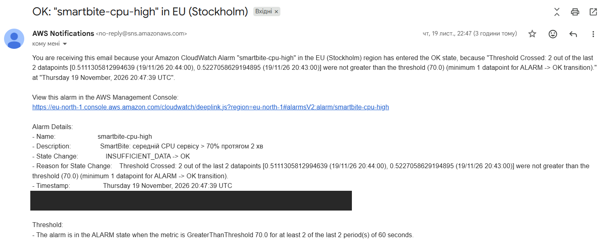

# Сповіщення

Terraform: [terraform/monitoring.tf](../terraform/monitoring.tf): `aws_cloudwatch_metric_alarm.cpu_high`,
`aws_sns_topic.alerts`, `aws_sns_topic_subscription.alerts_email`.

## Умова

**Середнє завантаження CPU сервісу > 70 % протягом 2 хвилин** (`period = 60`,
`evaluation_periods = 2`, `datapoints_to_alarm = 2`).

* `alarm_actions` → SNS → **лист при переході OK → ALARM** (надмірне навантаження);
* `ok_actions` → SNS → **лист при поверненні ALARM → OK** (норма).
* `treat_missing_data = notBreaching`: якщо даних немає (наприклад, сервіс щойно
  створено), тривоги немає.

Канал — SNS-тема `smartbite-alerts` з підпискою `email` (адреса `alert_email`, за
замовчуванням `budget_email`). Після `terraform apply` приходить лист
**AWS Notification - Subscription Confirmation**. Посилання в ньому обов'язково
треба підтвердити, інакше листи тривоги не доставлятимуться.

### Чому така умова

* **70 % вище за ціль масштабування (60 %).** Перетин 60 % — це нормальна робота:
  автоскейлер просто додає задачу. Тривога потрібна, коли масштабування не встигає
  або вже вичерпане, і CPU тримається помітно вище цілі.
* **2 хвилини, а не миттєво.** Одна точка понад поріг буває через короткий сплеск,
  наприклад кілька одночасних генерацій плану. Без вимоги «N хвилин поспіль» тривога
  перемикалася б ALARM ↔ OK кожну хвилину (flapping), і листи перестали б читати.
* **Чому не p95 > 500 мс.** Для користувача латентність важливіша за CPU. Але у SmartBite
  `POST /generate-plan` триває ~0.3–1.5 с навіть без навантаження, і p95 по всіх запитах
  легко перевищує 500 мс у звичайному режимі. Така тривога була б хибною. Для реального
  сервісу варто додати тривогу на p95 саме читань (окремий target group або метрика з логів).

## Листи

> Знімки покласти в `docs/img/`.

| | Знімок | Отримано о |
|---|---|---|
| ALARM |  | 23:11:39 (перехід OK → ALARM) |
| OK |  | 23:15:39 (перехід ALARM → OK) |

Історія стану (`aws cloudwatch describe-alarm-history --alarm-name smartbite-cpu-high`):

```
23:11:39  Alarm updated from OK to ALARM     ← прогін 1
23:15:39  Alarm updated from ALARM to OK
23:43:39  Alarm updated from OK to ALARM     ← прогін 2
```

## Час реакції

| Подія | Прогін 1 | Прогін 2 |
|---|---|---|
| Початок сталого навантаження (3:00 від старту k6) | 23:07:22 | 23:39:47 |
| Перша хвилина CPU > 70 % на панелі | 23:07 (86 %) | 23:39 (96 %) |
| Тривога ALARM | 23:11:39 | 23:43:39 |
| **Від початку сталого навантаження до тривоги** | **4 хв 17 с** | **3 хв 52 с** |

Лист приходить через секунди після переходу в ALARM.

Складові затримки:

1. CPU має реально перевищити 70 %. Під час наростання це стається ще до сталої фази
   або на її початку.
2. **2 хвилини** оцінювання (2 точки поспіль).
3. Затримка публікації метрики ECS у CloudWatch: ~1 хв, бо точка за хвилину
   з'являється після її завершення.
4. Обробка alarm і доставка SNS → email: секунди, іноді до хвилини.

Виміряно **~4 хв** від перевищення порогу до листа. Найбільша частка затримки —
оцінювання alarm і відставання метрики, а не доставка листа.

Лист OK прийшов о 23:15:39, через ~1 хв після кінця навантаження, хоча задачі
вилучались ще 15–19 хв. Тривога дивиться на CPU, який після спаду одразу падає,
а не на кількість задач.

### Чи прийнятно це для реального сервісу

Для сповіщення про **перевантаження, яке автоматика повинна прибрати сама** — так.
За 3–4 хв автоскейлер зазвичай уже додає задачі, і лист лише повідомляє людині про
подію. Будити чергового через 30 с не потрібно. Для **падіння сервісу** (5xx, ALB
не має здорових цілей) цього замало: там варто реагувати за 1 хв (1 точка
`HTTPCode_ELB_5XX_Count > 0` або health check), а канал має бути не email, а
месенджер/PagerDuty. Email може приходити із затримкою і легко губиться серед інших листів.
