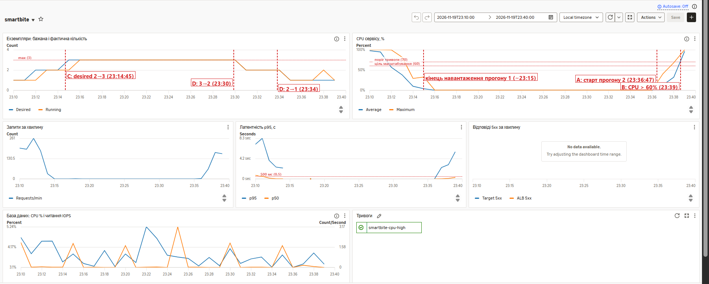

# Автоматичне масштабування і панель моніторингу

Terraform: [terraform/autoscaling.tf](../terraform/autoscaling.tf), [terraform/monitoring.tf](../terraform/monitoring.tf).

## Параметри політики

| Параметр | Значення | Де |
|---|---|---|
| Тип політики | `TargetTrackingScaling` | `aws_appautoscaling_policy.cpu` |
| Метрика | `ECSServiceAverageCPUUtilization`: середній CPU усіх задач сервісу | |
| Ціль | **60 %** | `var.autoscaling_cpu_target` |
| Мінімум / максимум задач | **1 / 3** | `var.autoscaling_min`, `var.autoscaling_max` (валідація ≤ 4) |
| `scale_out_cooldown` | **60 с** | |
| `scale_in_cooldown` | **180 с** | |
| Розмір задачі | 0.25 vCPU / 512 MiB | `aws_ecs_task_definition.app` |

### Чому CPU і чому 60 %

Найважча операція SmartBite — `POST /generate-plan`. Пошук плану на тиждень витрачає
приблизно 320 мс чистого процесорного часу на ноутбуці, а на 0.25 vCPU Fargate ще більше.
Тут вузьке місце саме процесор застосунку, а не база, тому середній CPU добре
показує навантаження.

Чому ціль 60 %, а не 80–90 %:

* **Запас на час реакції.** Нова задача з'являється приблизно через 2–4 хв після
  перевищення порогу (див. нижче). Весь цей час навантаження тримають наявні задачі.
  З ціллю 60 % вони мають ще ~40 % запасу, а з ціллю 90 % латентність зросла б одразу.
* **Python і GIL.** Один процес uvicorn фактично використовує одне ядро. Ближче до 100 %
  черга запитів і p95 ростуть дуже різко.
* **Нижче теж погано.** З ціллю 30–40 % сервіс тримав би вдвічі більше задач, ніж треба,
  і переплачував би.

Межа 3 задачі: 3 × 0.25 vCPU цілком вистачає для тестового навантаження і вкладається
в бюджет. Умова дозволяє до 4.

### Що таке період стабілізації (cooldown)

Cooldown — це час після дії масштабування, коли автоскейлер не робить наступну дію
того самого типу. За цей час він чекає, поки ефект попередньої дії з'явиться в метриці.
Нова задача стартує не одразу: треба завантажити образ, запустити контейнер і двічі
пройти health check ALB з інтервалом 30 с. Тільки після цього вона бере на себе трафік,
і середній CPU падає.

* `scale_out_cooldown = 60` — після додавання задачі наступну можна додати через 60 с.
  Це коротко, бо недодати задачу під навантаженням гірше, ніж додати зайву.
* `scale_in_cooldown = 180` — задачі вилучаються по одній із паузою. Так сервіс не
  «провалиться» під час короткого затишшя.

**Якщо cooldown = 0:** автоскейлер реагує на кожну точку метрики, не дочекавшись
результату попереднього кроку. Поки перша нова задача ще стартує, CPU досі високий,
і він додає другу, третю, четверту. Сервіс стрибає одразу до максимуму (overshoot),
а потім так само різко вилучає задачі. Кількість екземплярів коливається (flapping):
зайві витрати, постійні старти й зупинки, а запити, що були на зупинених задачах,
обриваються. У target tracking захист частково є й без cooldown: alarm-и мають
3 і 15 точок оцінювання. Але cooldown саме і прибирає повторні дії, поки система
ще не встигла відреагувати.

## Як target tracking працює всередині

AWS сам створює два CloudWatch-alarm-и для політики (їх видно в CloudWatch → Alarms,
імена `TargetTracking-service/smartbite/smartbite-AlarmHigh-…` / `-AlarmLow-…`):

* **AlarmHigh**: CPU > 60 % у **3 з 3** хвилинних точок → додати задачі;
* **AlarmLow**: CPU < ~54 % (90 % від цілі) у **15 з 15** хвилинних точок → вилучити.

Звідси асиметрія, яку видно на панелі.

## Панель моніторингу

CloudWatch → Dashboards → `smartbite` (`terraform output dashboard_url`). Графіки:

1. **Екземпляри**: `DesiredTaskCount` (рішення автоскейлера) і `RunningTaskCount`
   (фактично запущені) з `ECS/ContainerInsights`. Container Insights увімкнено в
   `aws_ecs_cluster.main`.
2. **CPU сервісу**: `AWS/ECS CPUUtilization` (Average і Maximum) з лініями цілі 60 % і
   порогу тривоги 70 %.
3. **Запити за хвилину**: `AWS/ApplicationELB RequestCount`, Sum за 60 с.
4. **Латентність p95** (і p50): `TargetResponseTime`, лінія 500 мс.
5. **5xx**: `HTTPCode_Target_5XX_Count` (помилки застосунку) і `HTTPCode_ELB_5XX_Count`
   (502/503/504 від самого ALB, наприклад коли немає здорових цілей).
6. **База даних**: CPU і ReadIOPS RDS, для порівняння з кешем ([CACHE.md](CACHE.md)).
7. **Стан тривоги** `smartbite-cpu-high`.

## Прогін: знімки панелі

> Знімки зробити під час прогону `k6 run -e BASE_URL=... -e VUS=8 loadtest/smartbite.js`
> і покласти в `docs/img/`. На знімку позначити (стрілки/підписи) чотири моменти.

Прогін 1 (19.11.2026, без кешу, N = 8), час AWS (UTC+2), дані з CloudWatch і
`aws application-autoscaling describe-scaling-activities`:

| Момент | Час | Що видно |
|---|---|---|
| A. Початок навантаження | 23:04:22 | Запити/хв починають рости |
| B. Перетин порогу CPU 60 % | 23:06 | CPU 48 → 68 → 86 → 90 → 100 % |
| C. Поява екземпляра | 23:11:45 desired 1→2, ~23:13 Running 2; 23:14:45 desired →3 | після появи 2-ї задачі CPU 100 → 57 → 38 % |
| Кінець навантаження | ~23:14:50 | Запити/хв падають до 0 |
| D. Вилучення екземпляра | 23:30:09 desired 3→2; 23:34:09 desired 2→1 | через **15 хв** після кінця навантаження, потім ще 4 хв |

Прогін 2 (з кешем) дав ту саму картину: CPU > 60 % о 23:39, desired 1→2 о 23:44:45,
→3 о 23:46:45.

**Між B і C реально минає ~5.5 хв, між кінцем навантаження і D — 15 хв.**

### Чому між B і C минає час

Затримка складається з кількох частин, що йдуть одна за одною:

1. **Публікація метрики**: ECS віддає CPU в CloudWatch хвилинними точками з
   невеликою затримкою (~1 хв).
2. **Оцінювання alarm**: AlarmHigh спрацьовує після **3 хвилинних точок поспіль**
   над ціллю, тобто ≥ 3 хв від перетину.
3. **Рішення і запуск задачі**: Desired росте одразу, але Fargate треба виділити
   ресурси, завантажити образ з ECR через NAT і запустити контейнер (~30–60 с).
4. **Health check ALB**: задача отримує трафік лише після 2 успішних перевірок
   з інтервалом 30 с (≥ 60 с). Тому на графіку `Running`/падіння CPU відстає від `Desired`.

Виміряно: від перетину 60 % до рішення автоскейлера минуло ~5.5 хв (пункти 1–2),
і ще ~1–1.5 хв до того, як нова задача почала обробляти трафік (пункти 3–4). Перша
хвилина над порогом (68 %) припала на фазу наростання. Щоб AlarmHigh спрацював,
потрібні 3 точки поспіль, і кожна з'являється в CloudWatch із затримкою.

Ще одна особливість: третю задачу автоскейлер додав о 23:14:45, коли навантаження
вже спадало. Він реагує на метрики, що відстають на кілька хвилин. Тому
масштабування за CPU не замінює запасу потужності на випадок різких піків.

### Чому вилучення значно пізніше за падіння навантаження

* **AlarmLow вимагає 15 хвилинних точок поспіль** нижче цілі. AWS навмисно робить
  scale-in консервативним: передчасне вилучення під повторною хвилею навантаження
  гірше за 15 хв зайвої задачі.
* Після кожного вилучення діє `scale_in_cooldown = 180 с`, тому 3→1 займає ще кілька хвилин.
* Перед зупинкою задача знімається з ALB (`deregistration_delay = 30` с): нові запити
  на неї не йдуть, поточні дообробляються. Потім ECS надсилає SIGTERM, і uvicorn
  коректно завершує активні запити (graceful shutdown). Лише після цього `Running` зменшується.

Тому після тесту треба почекати **~20 хв**, поки кількість задач повернеться до 1.
