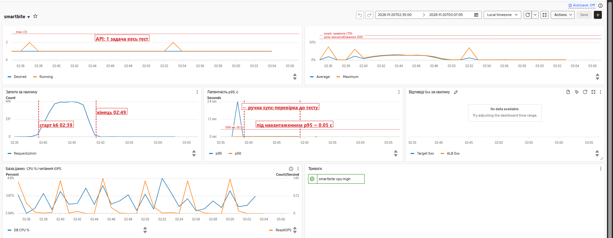
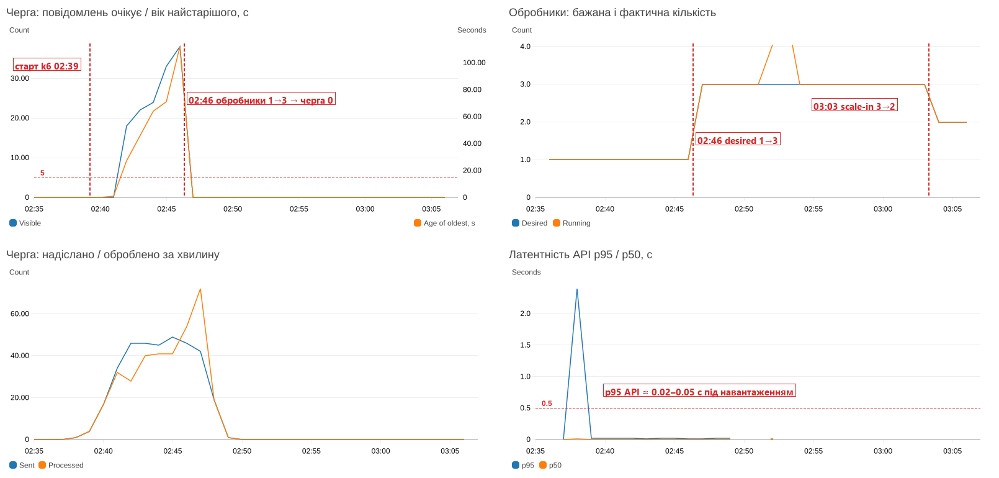

# Асинхронна обробка через чергу (бонус 6)

Код: [worker.py](../smartbite_python_backend/smartbite_python_backend/worker.py),
[jobs_queue.py](../smartbite_python_backend/smartbite_python_backend/jobs_queue.py),
`create_plan_job` / `get_plan_job` у [main.py](../smartbite_python_backend/smartbite_python_backend/main.py).
Інфраструктура: [terraform/queue.tf](../terraform/queue.tf).

## Що винесено в чергу і чому

Генерація плану (`solve_week`) — найважча операція SmartBite: ~2.3 с CPU на 0.25 vCPU.
У синхронному варіанті вона виконується в тому самому процесі, що обслуговує читання.
Під навантаженням усі запити стоять у черзі до процесора, і p95 доходить до 6–8 с
([LOADTEST.md](LOADTEST.md)).

Тепер є асинхронний варіант:

```
клієнт ──POST /plan-jobs──▶ API ──INSERT plan_jobs (queued)──▶ PostgreSQL
                             │──SendMessage {job_id}──▶ SQS smartbite-plan-jobs
       ◀──202 Accepted───────┘   (Location: /plan-jobs/{job_id})

                      SQS ──ReceiveMessage──▶ worker (окремий ECS-сервіс, 1–3 задачі)
                                               ├─ UPDATE … SET status='processing' WHERE status='queued'
                                               ├─ solve_week(...)
                                               ├─ INSERT meal_plans + UPDATE status='done'  (одна транзакція)
                                               └─ DeleteMessage

клієнт ──GET /plan-jobs/{job_id}──▶ {"status": "done", "plan_id": 812, "plan_url": "…/plans/812"}
```

* **API** лише пише рядок у таблицю і кладе повідомлення в чергу: це мілісекунди.
  Важкої роботи в API більше немає.
* **Обробник** — той самий Docker-образ з командою `python worker.py`, окремий
  ECS-сервіс зі своєю IAM-роллю (лише Receive/Delete на одну чергу).
* **Масштабування обробника** — target tracking за `ApproximateNumberOfMessagesVisible`
  (ціль 5 повідомлень, від 1 до 3 задач). Черга росте → додаються обробники.
* **Dead-letter queue.** Повідомлення, яке не вдалося обробити 3 рази, SQS переносить
  у `smartbite-plan-jobs-dlq`, щоб воно не крутилося в черзі вічно.
* Синхронний `POST /generate-plan` залишився для сумісності.

## Що змінилося для клієнта

| | `POST /generate-plan` (201/200) | `POST /plan-jobs` (202) |
|---|---|---|
| Відповідь | готовий план | лише квитанція: `job_id`, `status: queued` |
| Час відповіді | секунди, росте з навантаженням | мілісекунди, від навантаження майже не залежить |
| Результат | одразу в тілі | пізніше, окремим запитом |
| Помилка генерації | 400 у відповіді | `status: failed` + `error` у статусі завдання |
| Таймаут під навантаженням | можливий (клієнт не знає, чи план створено) | ні — завдання прийняте і чекає в черзі |

Код **202 Accepted** означає «запит прийнято до виконання, але ще не виконано».
Клієнт не може одразу показати план. Він має показати «генеруємо…» і дізнатися
результат іншим способом.

### Як клієнт дізнається результат

1. **Опитування (polling)** — реалізовано. Відповідь 202 містить заголовок `Location`
   і поле `status_url`. Клієнт періодично робить `GET /plan-jobs/{job_id}`, поки
   `status` не стане `done` (тоді є `plan_id` і `plan_url`) або `failed`.
   Розумний інтервал — 1–2 с з поступовим збільшенням.
2. Альтернативи для реального продукту: **webhook** (клієнт передає URL, обробник
   викликає його по завершенні), **WebSocket/SSE** (сервер сам надсилає подію
   в браузер), **push-сповіщення** на мобільний.

## Доставка «щонайменше один раз» і повторна обробка

SQS standard гарантує **at-least-once**. Кожне повідомлення буде доставлене,
але **може бути доставлене більше одного разу**:

* обробник отримав повідомлення, згенерував план, але впав (або його зупинив
  scale-in) **до** `DeleteMessage`. Через visibility timeout (60 с) повідомлення
  знову стає видимим і його отримає інший обробник;
* обробка тривала довше за visibility timeout;
* рідко — сама SQS віддає копію (розподілене сховище).

Протилежна гарантія — **at-most-once**: повідомлення видаляється до обробки.
Дублів немає, але при збої завдання губиться. Черги обирають at-least-once,
бо дубль можна відфільтрувати на боці обробника, а втрачене повідомлення
відновити неможливо.

**Що буде при повторній обробці в SmartBite** — нічого поганого, обробник ідемпотентний:

1. Завдання **захоплюється** умовним `UPDATE plan_jobs SET status='processing'
   WHERE id=? AND status='queued'`. Якщо оновився 0 рядків, завдання вже
   виконане (`duplicate` → повідомлення видаляється) або його зараз виконує інший
   обробник (`busy` → повідомлення повернеться пізніше).
2. План і статус `done` записуються **в одній транзакції**. Стану «план створено,
   а завдання ще не done» не буває.
3. Якщо обробник упав після захоплення, але до commit, завдання зависає в
   `processing`. Через 45 с (`CLAIM_TIMEOUT`, менше за visibility timeout) його
   можна захопити знову.

Без цих кроків повторна доставка створила б **другий однаковий план** — та сама
проблема, що й з повтором HTTP-запиту ([IDEMPOTENCY.md](IDEMPOTENCY.md)).
Перевіряє тест `test_worker.py::test_job_lifecycle_and_duplicate_delivery`:
`process_job` двічі для одного завдання → `done`, потім `duplicate`, у базі один план.

**Graceful shutdown обробника.** При scale-in ECS надсилає SIGTERM. Обробник
дообробляє поточне повідомлення, видаляє його і виходить (`stopTimeout = 30` с).
Тому зменшення кількості обробників не створює зайвих повторних доставок.

## Прогін під навантаженням

```bash
k6 run -e BASE_URL=$(terraform -chdir=terraform output -raw app_url) -e MODE=async loadtest/smartbite.js
```

Той самий профіль (1 запис : 9 читань, N = 8, 3 + 5 + 2 хв), але запис — `POST /plan-jobs`.
«Читання щойно створеного» спершу перевіряє статус завдання.

### Результати (20.11.2026, N = 8)

Файл: `loadtest/results/summary-async-cache-on-2026-11-20T00-51-51.json`.

| Показник | Синхронно (прогін 2, з кешем) | **Через чергу** |
|---|---|---|
| Усього запитів за 10 хв | 1658 | **3490** |
| Запитів за секунду | 2.73 | **5.81** (×2.1) |
| Помилки | 0.18 % | **0 %** |
| Усі запити p50 / p95 / p99 | 228 мс / 8.3 с / 14.5 с | **34 / 47 / 68 мс** |
| Запис p50 / p95 | 8.3 с / 15.0 с | **44 / 63 мс** (лише постановка в чергу) |
| Читання p95 | 1.6 с | **43 мс** |
| CPU API | 86–100 %, масштабування до 3 задач | **≤ 14 %, 1 задача** |
| Частка влучань у кеш | 96 % | 98.6 % |

Користувачі встигли зробити вдвічі більше дій: раніше вони чекали на генерацію
плану, тепер ні.

### Що відбувалось із чергою (час AWS, UTC+2)

| Час | Подія |
|---|---|
| 02:39:12 | старт k6 |
| 02:40–02:41 | 17 → 34 завдання/хв, 1 обробник встигає: черга порожня, CPU обробника 44 → 71 % |
| 02:42:12 | стале навантаження: ~46 завдань/хв, обробник встигає лише ~40/хв |
| 02:42–02:46 | черга росте **18 → 22 → 24 → 33 → 38** повідомлень, найстаріше чекає до **112 с**, CPU обробника 100 % |
| 02:46:20 | автоскейлер обробника: **desired 1 → 3** |
| 02:47 | 3 обробники розібрали чергу: оброблено **72 завдання/хв**, черга **0** |
| 02:47:12–02:49:12 | спад; API весь час на 1 задачі, CPU ≤ 14 % |

Головне:
* **Латентність API не зростає**: p95 47 мс протягом усього тесту, бо API більше
  не виконує важку роботу. Навантаження, від якого раніше росли p95 і кількість
  API-задач, тепер видно як **довжину черги**.
* **Обробник масштабується від довжини черги**: коли черга довго трималась вище
  цілі (5), автоскейлер додав обробники, і черга спорожніла за хвилину.
* Ціна — **затримка результату** (eventual consistency). На піку завдання чекало
  в черзі до 112 с. Коли клієнт перевіряв статус через кілька секунд після
  створення, завдання було готове лише в 22 % випадків (`job_done_when_checked`).
  Тому клієнт має показувати «генеруємо…» і опитувати статус, а не чекати одразу.
* Обробники додались лише через ~4 хв після початку росту черги: та сама затримка
  alarm-ів target tracking, що й для CPU ([AUTOSCALING.md](AUTOSCALING.md)).
  Щоб реагувати швидше, можна масштабувати за `ApproximateAgeOfOldestMessage`
  (наприклад, ціль 30 с) або тримати мінімум 2 обробники.

Панель API під час прогону через чергу. Запитів до 474/хв (у синхронному режимі
було ~260), але p95 тримається біля нуля (~0.05 с), API весь час на 1 задачі,
CPU API ≤ 14 %. Пік p95 о 02:38 — це ручна перевірка синхронного
`POST /generate-plan` перед тестом, не навантаження.



Черга і обробники (графіки панелі `smartbite`, отримані через
`aws cloudwatch get-metric-widget-image` за той самий проміжок). На сталому
навантаженні черга росте вище цілі 5 до 38 повідомлень, найстаріше чекає до 112 с.
О 02:46 обробників стає 1 → 3, оброблених завдань — 72/хв, черга порожня.
Обробники вилучаються повільно: 3 → 2 лише о 03:03, через ~15 хв після того, як черга
спорожніла (та сама 15-хвилинна умова AlarmLow, що й для API). Короткий сплеск Running
до 4 о 02:52 — ECS замінював задачу. Затримка API весь час біля нуля. Пік о 02:38 —
ручна перевірка до тесту.


